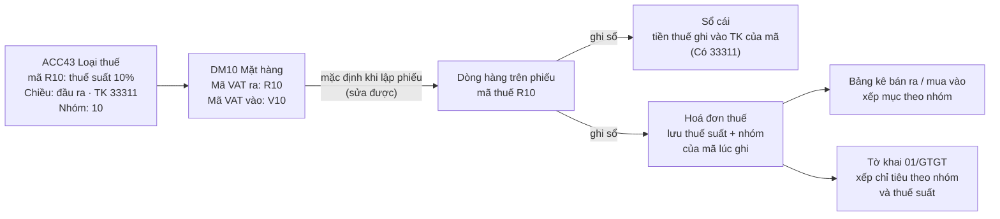
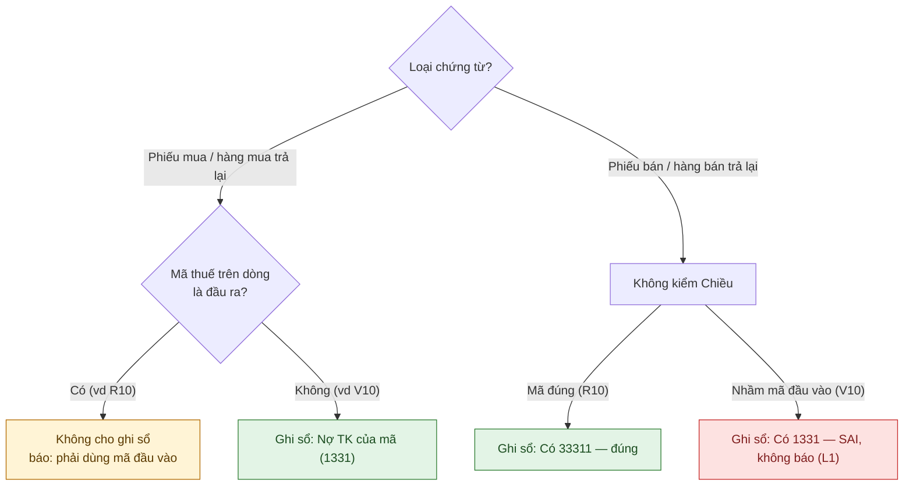
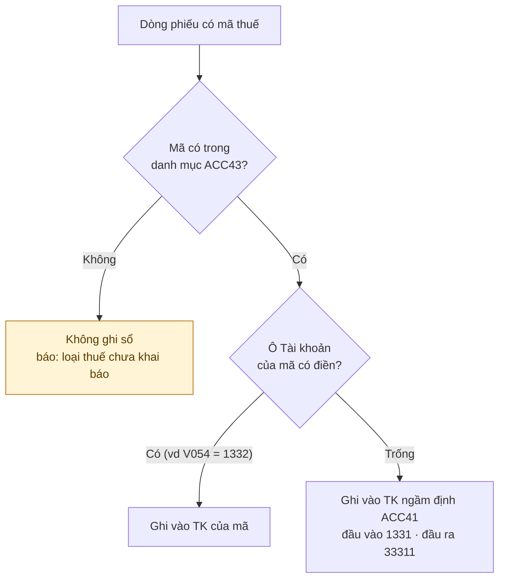
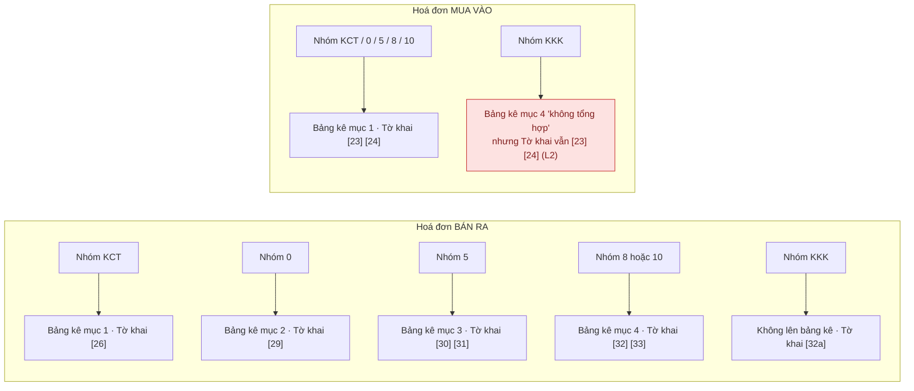

# Phụ lục NT-DM-011 · Danh mục Loại thuế (ACC43): ba ô Chiều, Tài khoản, Nhóm trên bảng kê đang hoạt động thế nào
<!-- [2026-11-19 kiennt] NGHIEM-THU — hiện trạng trước khi sửa, viết cho kế toán (đóng góp) -->

Tài liệu mô tả cách phần mềm **đang** xử lý (19/11/2026, trước khi sửa theo NT-DM-011) ba ô trên màn **ACC43 Loại thuế**: **Chiều**, **Tài khoản**, **Nhóm trên bảng kê** — mỗi ô ảnh hưởng tới bút toán, bảng kê, tờ khai GTGT ra sao, và những chỗ đang có thể sai.

## 1. Mỗi loại thuế là gì

Mỗi dòng ở ACC43 là **một mã thuế**: Mã · Tên · Thuế suất · Chiều · Tài khoản · Nhóm trên bảng kê · Đang dùng.

- **Một mã chỉ dùng cho một chiều.** Thuế 10% khi mua là mã **V10**, khi bán là mã **R10** — hai mã riêng, vì tiền thuế mua và tiền thuế bán ghi vào hai tài khoản khác nhau.
- Danh mục gốc có **51 mã**: 31 mã đầu vào (V…, KKKN) và 20 mã đầu ra (R…, KCT, VAT5). Bộ mã lấy theo dữ liệu đang dùng trên HTsoft.
- **Mặt hàng (DM10)** gắn sẵn hai mã: *Mã VAT ra* (dùng khi bán) và *Mã VAT vào* (dùng khi mua). Trên form mặt hàng chỉ có một ô "Thuế suất GTGT": chọn 8% thì phần mềm gán R08 cho bán và tự ghép V08 cho mua.
- Khi lập phiếu, dòng hàng **lấy mã thuế của mặt hàng làm mặc định**; người lập đổi được. Từ lúc ghi sổ, phần mềm chỉ dựa vào **mã thuế trên dòng phiếu**, không đọc lại mặt hàng — đổi thuế của mặt hàng chỉ có tác dụng với phiếu lập sau.

Một hoá đơn là **mua vào** hay **bán ra** do **loại chứng từ** quyết định (phiếu mua / phiếu bán), không do mã thuế.

**Sơ đồ 1 — Mã thuế đi qua phần mềm thế nào**



## 2. Ô Chiều (đầu vào / đầu ra)

**Ý nghĩa.** Đầu vào = thuế GTGT **được khấu trừ** khi mua. Đầu ra = thuế GTGT **phải nộp** khi bán.

**Phần mềm đang dùng ô này để:**

**Sơ đồ 2 — Kiểm Chiều khi ghi sổ**




| Ở đâu | Phần mềm làm gì |
|---|---|
| Ghi sổ **phiếu mua, hàng mua trả lại** | Nếu dòng hàng dùng mã **đầu ra** (vd R10) mà có tiền thuế → **không cho ghi sổ**, báo "phiếu mua phải dùng mã đầu vào (V05, V08, V10…)". |
| Ghi sổ **phiếu bán, hàng bán trả lại** | **Không kiểm tra.** Dùng nhầm mã đầu vào (vd V10) vẫn ghi sổ được — xem lỗi L1. |
| Danh sách chọn thuế trên các màn | DM10 Mặt hàng: chỉ hiện mã đầu ra · CN02 / CN03 Ghi tăng công nợ: theo phải thu / phải trả · ACC16 Phiếu kế toán, phiếu thu / chi, bút toán mẫu: **hiện lẫn cả mã mua và mã bán** · ghi sổ tài sản: **gõ tay mã thuế**. |
| Tờ khai 01/GTGT | **Không dùng** ô này — tờ khai xếp mua vào / bán ra theo loại chứng từ. |

## 3. Ô Tài khoản

**Ý nghĩa.** Tài khoản ghi **tiền thuế** trên sổ cái:

| TK | Khi nào | Mã ví dụ |
|---|---|---|
| 1331 | Thuế GTGT được khấu trừ của hàng hoá, dịch vụ | V05, V08, V10 |
| 1332 | Thuế GTGT được khấu trừ của **tài sản cố định** | V054, V104, V00C |
| 33311 | Thuế GTGT đầu ra phải nộp | R05, R08, R10 |

Cùng 5% đầu vào nhưng V05 ghi 1331 còn V054 ghi 1332 — nên tài khoản phải khai theo **từng mã**, không theo thuế suất.

**Sơ đồ 3 — Tiền thuế ghi vào tài khoản nào**



**Bút toán phần mềm đang lập** (dòng hàng 10.000.000đ, thuế 10%):

```
Mua hàng, mã V10 (TK 1331):            Bán hàng, mã R10 (TK 33311):
Nợ 156   10.000.000                     Nợ 131   11.000.000
Nợ 1331   1.000.000  ← TK của mã V10        Có 511   10.000.000
    Có 331  11.000.000                      Có 33311  1.000.000  ← TK của mã R10
```

- Ô Tài khoản **để trống** → phần mềm lấy tài khoản ngầm định ở **ACC41 Quy tắc hạch toán** (thuế đầu vào 1331, thuế đầu ra 33311).
- Sổ cái **giữ nguyên** tài khoản đã ghi; sửa TK của mã chỉ áp dụng cho chứng từ ghi sau.
- **Bảng kê thuế** lại hiện **tài khoản hiện tại** của mã, không phải tài khoản đã ghi sổ — xem lỗi L3.
- Ngoài tiền thuế, các phần khác của bút toán (doanh thu, giá vốn, kho, phải thu / phải trả) **không** lấy từ mặt hàng mà từ ACC41, loại kho, hình thức thanh toán.

## 4. Ô Nhóm trên bảng kê

**Ý nghĩa.** Hoá đơn dùng mã thuế này được xếp vào **mục nào** trên bảng kê và **chỉ tiêu nào** trên tờ khai 01/GTGT. Không suy được từ thuế suất vì có ba loại cùng thuế suất 0 nhưng khác nhau về thuế:

| Nhóm | Ý nghĩa | Mã ví dụ |
|---|---|---|
| KCT | Hàng **không chịu thuế GTGT** | KCT, V13K |
| 0 | Hàng **chịu thuế suất 0%** (xuất khẩu) — vẫn được khấu trừ đầu vào | R00, V00 |
| 5 / 8 / 10 | Chịu thuế suất 5% / 8% / 10% | R05, R08, R10, V05… |
| KKK | **Không phải kê khai, tính nộp** thuế GTGT | KKKN |

**Cách phần mềm dùng:**

1. Khi ghi sổ, nhóm của mã được **lưu vào từng dòng hoá đơn**. Sửa nhóm của mã về sau **không** đổi các hoá đơn đã ghi — muốn đổi phải ghi lại chứng từ.
2. Bảng kê và tờ khai đọc **nhóm đã lưu trên hoá đơn**:

**Sơ đồ 4 — Hoá đơn lên bảng kê và tờ khai ở đâu**




| Nhóm | Bảng kê **bán ra** | Bảng kê **mua vào** | Tờ khai — **bán ra** | Tờ khai — **mua vào** |
|---|---|---|---|---|
| KCT | Mục 1. Không chịu thuế | Mục 1. Dùng riêng cho SXKD chịu thuế | [26] | [23] [24] |
| 0 | Mục 2. Thuế suất 0% | Mục 1 | [29] | [23] [24] |
| 5 | Mục 3. Thuế suất 5% | Mục 1 | [30] [31] | [23] [24] |
| 8 | Mục 4. Thuế suất 10% (gồm 8%, kèm phụ lục giảm thuế) | Mục 1 | [32] [33] | [23] [24] |
| 10 | Mục 4. Thuế suất 10% | Mục 1 | [32] [33] | [23] [24] |
| KKK | *không có mục — không cộng vào bảng kê* | Mục 4. Không phải tổng hợp trên tờ khai | [32a] | **[23] [24]** |

- Phía **mua vào**, tờ khai cộng **mọi** hoá đơn vào [23] (giá trị) và [24] (thuế), không phân biệt nhóm; [25] trừ phần hoá đơn được đánh dấu không đủ điều kiện khấu trừ.
- Phía **bán ra**, tờ khai dựa vào nhóm cho hàng không chịu thuế (KCT) và 0%; với 5%, 8%, 10% dựa vào thuế suất.

## 5. Những chỗ đang có thể sai

| # | Hiện tượng | Hậu quả với kế toán | Mức |
|---|---|---|---|
| L1 | Phiếu bán / hàng bán trả lại chọn nhầm mã **đầu vào** (vd V10 thay vì R10): phần mềm vẫn ghi sổ, không báo | Thuế đầu ra ghi **Có 1331** thay vì Có 33311 — số dư 1331 và 33311 đều sai, phải điều chỉnh | **Sai sổ cái** |
| L2 | Hoá đơn mua vào mã **KKKN** (nhóm Không kê khai) có tiền thuế | Bảng kê mua vào xếp vào mục "không tổng hợp trên tờ khai", nhưng tờ khai vẫn cộng vào [23] [24] — **hai báo cáo lệch nhau** | Lệch tờ khai |
| L3 | Sửa tài khoản của một mã đã có chứng từ (vd V05 từ 1331 sang 1332) | Bảng kê các kỳ cũ hiện 1332, sổ cái vẫn 1331 — **đối chiếu không khớp** | Lệch báo cáo |
| L4 | Khai nhóm sai / gõ giá trị lạ cho một mã | Hoá đơn của mã đó **không được cộng** vào bảng kê, không có cảnh báo | Thiếu số bảng kê |
| L5 | Bảng kê **mua vào** không chia theo **mục đích sử dụng** như HTsoft (dùng riêng / dùng chung / dự án đầu tư / không kê khai) — gần như mọi hoá đơn vào mục 1 | Không lập được bảng kê mua vào đúng bố cục cũ; chưa tính được **khấu trừ theo tỷ lệ** cho hàng dùng chung | Thiếu chức năng |
| L6 | Dữ liệu demo Ớt Chuông: V053, V083, V103 (hàng **dùng chung**, **có chịu thuế** 5% / 8% / 10%) đang khai nhóm **KCT** (không chịu thuế); danh mục gốc ghi đúng 5 / 8 / 10 | Hiện chưa làm sai số (vì L5), nhưng khai sai bản chất | Sai dữ liệu |
| L7 | Phiếu bán lập tay (BH10 / BH11) và chứng từ mua (MH03) chỉ biết một số mã chuẩn | Mã mới (vd R07, R08A) bị tính **tiền thuế = 0** hoặc không chọn được | Sai tiền thuế |
| L8 | Đơn bán từ website / máy bán qua cầu nối WordPress không dùng mã thuế của mặt hàng mà tự đặt theo thuế suất (8% → R08) | Mã đặt tên khác quy ước R + thuế suất không dùng được cho đơn từ website; thuế suất lạ (7%) mà chưa có R07 → chứng từ **không ghi sổ được** | Chặn ghi sổ |

**Phiếu NT-DM-011 xử lý:** L7 (ở các màn trong phạm vi), và giảm khả năng xảy ra L1, L4 nhờ chọn theo thuế suất — phần mềm tự lấy đúng mã mua / bán, nhóm tự điền theo thuế suất.
**Cần phiếu riêng:** L1 (chặn ở khâu ghi sổ), L2, L3, L5, L6 (sửa dữ liệu demo), L8.

## 6. So với HTsoft

| Trên HTsoft | Phần mềm mới |
|---|---|
| Mã, tên, thuế suất | Giữ nguyên |
| Loại: thuế ra / thuế vào | Ô Chiều — giữ nguyên |
| Tài khoản thuế (33311; 1331; 1332 cho dự án đầu tư; 13888 cho thuế kỳ sau) | Ô Tài khoản — giữ nguyên |
| Mã nhóm báo cáo thuế — **bán ra**: không chịu thuế / 0% / 5% / 10% (8% đi chung 10%) · **mua vào**: dùng riêng / dùng chung / dự án đầu tư / không kê khai | Ô Nhóm trên bảng kê — **đổi**: cả mua và bán dùng chung danh sách KCT / 0 / 5 / 8 / 10 / KKK, phía mua **mất phân loại theo mục đích** (L5) |
| Giá đã gồm thuế | Bỏ |
