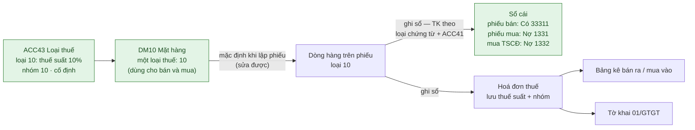
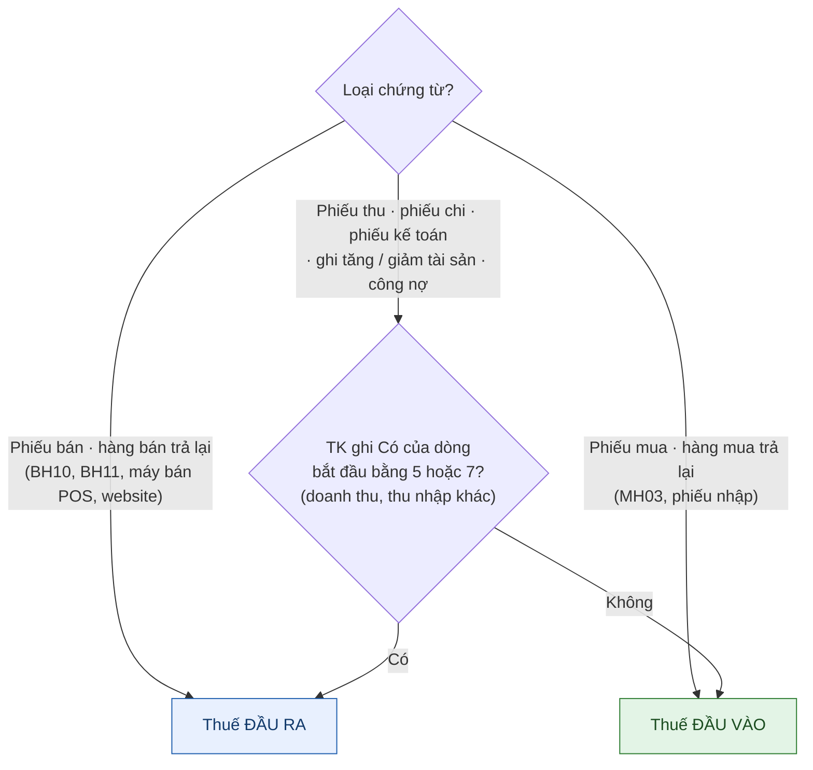
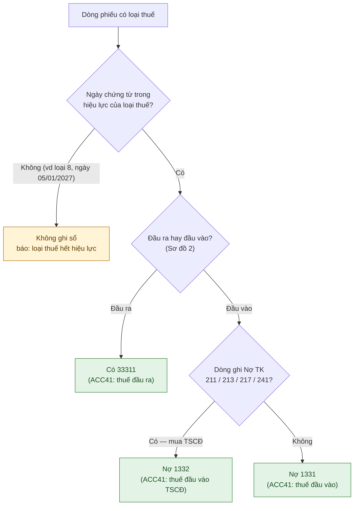
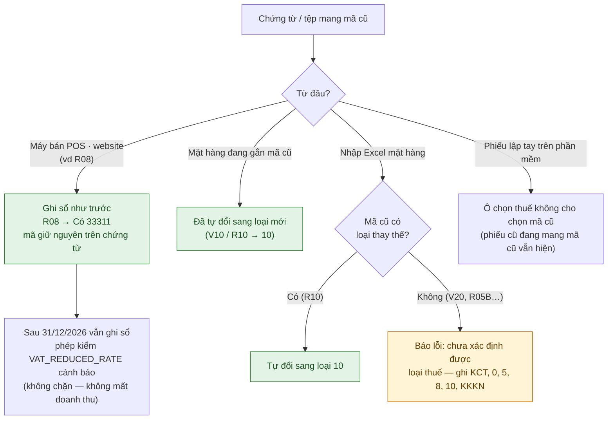

# Phụ lục NT-DM-012 · Loại thuế GTGT cố định theo quy định: logic sau khi sửa
<!-- [2026-11-19 kiennt] NGHIEM-THU — logic sau khi sửa theo NT-DM-012, viết cho kế toán; đối chiếu với phụ lục hiện trạng NT-DM-011 (đóng góp) -->

Tài liệu mô tả cách phần mềm xử lý thuế GTGT **sau khi sửa** theo phiếu NT-DM-012 (code xong 19/11/2026, chưa đưa lên bản chạy chung). Đọc cùng *Phụ lục NT-DM-011 — hiện trạng*: mỗi mục dưới đây trả lời "trước thế nào → giờ thế nào".

Ba thay đổi chính:

1. **Danh mục loại thuế do phần mềm cấu hình sẵn** theo quy định nhà nước — 6 loại, người dùng chỉ xem.
2. **Bỏ ô Chiều**: một loại dùng cho cả mua và bán.
3. **Bỏ ô Tài khoản**: tiền thuế ghi vào tài khoản ở **ACC41 Quy tắc hạch toán**; mua tài sản cố định tự ghi **1332**.

## 1. Danh mục loại thuế (ACC43) — 6 loại cố định

| Loại | Thuế suất | Nhóm trên bảng kê | Hiệu lực | Căn cứ |
|---|---|---|---|---|
| **KCT** — Không chịu thuế | 0 | KCT | không giới hạn | Luật Thuế GTGT 48/2024/QH15 |
| **0** — Thuế suất 0% | 0 | 0 | không giới hạn | Luật Thuế GTGT 48/2024/QH15 |
| **5** — Thuế suất 5% | 5 | 5 | không giới hạn | Luật Thuế GTGT 48/2024/QH15 |
| **8** — Thuế suất 8% (giảm từ 10%) | 8 | 8 | **đến hết 31/12/2026** | NQ 204/2025/QH15; NĐ 174/2025/NĐ-CP |
| **10** — Thuế suất 10% | 10 | 10 | không giới hạn | Luật Thuế GTGT 48/2024/QH15 |
| **KKKN** — Không phải kê khai, tính nộp | 0 | KKK | không giới hạn | Luật Thuế GTGT 48/2024/QH15 và văn bản hướng dẫn |

- Màn ACC43 **chỉ xem**: không còn nút Thêm / Sửa / Xoá / Nhập Excel. Gọi thẳng API thêm / sửa / xoá cũng bị chặn ("do phần mềm cấu hình sẵn theo quy định nhà nước").
- Nhà nước đổi thuế suất (vd hết thời gian giảm 8%, có thuế suất mới) → **bản cập nhật phần mềm** đổi danh mục, không để từng đơn vị tự khai.
- **Nhóm trên bảng kê** không còn là ô người dùng khai: mỗi loại có sẵn nhóm đúng (KCT, 0, 5, 8, 10, KKK). Cách xếp hoá đơn lên bảng kê và tờ khai **giữ như cũ** (Sơ đồ 4 của phụ lục hiện trạng).

**Sơ đồ 1 — Loại thuế đi qua phần mềm thế nào (sau khi sửa)**



## 2. Bỏ ô Chiều — một loại cho cả mua và bán

**Trước:** thuế 10% có hai mã — **V10** khi mua, **R10** khi bán. Chọn nhầm mã là sai tài khoản (lỗi L1).

**Giờ:** chỉ có loại **10**. Hoá đơn là mua vào hay bán ra do **loại chứng từ** quyết định — điều này vốn đã đúng với bảng kê và tờ khai, nay áp dụng cả cho bút toán.

**Sơ đồ 2 — Phần mềm biết thuế đầu vào hay đầu ra**



- Ví dụ phiếu thu bán phế liệu: Nợ 1111 / **Có 5118**, loại 10 → thuế **đầu ra**, ghi Có 33311.
- Ví dụ phiếu chi mua văn phòng phẩm: **Nợ 6422** / Có 1111, loại 10 → thuế **đầu vào**, ghi Nợ 1331.
- Mặt hàng (DM10) chỉ còn **một** ô *Thuế suất GTGT*; trong dữ liệu, *Mã VAT ra* và *Mã VAT vào* luôn cùng một loại.

## 3. Bỏ ô Tài khoản — tài khoản thuế theo Quy tắc hạch toán (ACC41)

**Trước:** mỗi mã tự khai tài khoản (V05 → 1331, V054 → 1332, R05 → 33311). Cùng 5% đầu vào mà phải tách hai mã để ghi hai tài khoản.

**Giờ:** loại thuế không có tài khoản. Phần mềm chọn tài khoản theo **nghiệp vụ**, lấy từ ACC41:

| Nghiệp vụ | Khoá ở ACC41 | TK (TT 99/2025/TT-BTC) |
|---|---|---|
| Bán hàng, hàng bán trả lại, thu Có 5… / 7… | Thuế GTGT đầu ra | **33311** |
| Mua hàng hoá, dịch vụ | Thuế GTGT đầu vào | **1331** |
| Mua **tài sản cố định** — dòng ghi Nợ TK **211, 213, 217, 241** | Thuế GTGT đầu vào của TSCĐ (**khoá mới**) | **1332** |

**Sơ đồ 3 — Tiền thuế ghi vào tài khoản nào (sau khi sửa)**



**Bút toán phần mềm lập** (giá chưa thuế 10.000.000đ, loại 10):

```
Mua hàng hoá:                 Mua TSCĐ (máy in):             Bán hàng:
Nợ 156   10.000.000           Nợ 2112  10.000.000            Nợ 131   11.000.000
Nợ 1331   1.000.000           Nợ 1332   1.000.000  ← tự nhận     Có 511   10.000.000
    Có 331  11.000.000            Có 331  11.000.000             Có 33311  1.000.000
```

- Kế toán **không phải chọn mã riêng** cho TSCĐ (thay V054, V104, V00C trước đây) — phần mềm nhìn TK Nợ của dòng.
- Đơn vị chưa có TK 1332 trong hệ thống tài khoản → thuế TSCĐ ghi 1331 như hàng hoá.
- Đổi tài khoản ở ACC41 chỉ áp dụng cho chứng từ ghi sau; sổ cái đã ghi giữ nguyên.

## 4. Hiệu lực của loại thuế

Mỗi loại có **ngày bắt đầu / ngày hết hiệu lực** (trống = không giới hạn). Hiện chỉ loại **8** có hạn: **đến hết 31/12/2026**.

| Ở đâu | Phần mềm làm gì |
|---|---|
| Ô chọn thuế trên phiếu | Loại hết hiệu lực ở **ngày chứng từ** bị làm mờ, không chọn được |
| Ghi sổ (mọi loại chứng từ) | Ngày chứng từ ngoài hiệu lực → **không ghi sổ**, báo "Loại thuế 8 … hết hiệu lực sau ngày 31/12/2026 — chứng từ ngày … phải chọn lại loại thuế" |
| Loại thuế mặc định khi mặt hàng chưa khai | 8% cho chứng từ đến 31/12/2026, từ 01/01/2027 là 10% |
| Chứng từ ghi lùi ngày (rơi vào bản chính sách hạch toán cũ) | 6 loại vẫn dùng được — loại thuế là quy định nhà nước, không thuộc chính sách riêng của đơn vị |

## 5. Mã cũ (V…, R…) và chứng từ đã ghi

**Chứng từ đã ghi giữ nguyên**: sổ cái, bảng kê, tờ khai các kỳ đã qua không đổi. 51 mã cũ vẫn còn trong danh mục, đánh dấu **mã cũ** kèm **loại thay thế**; xem ở ACC43 bằng ô *Xem mã cũ*.

| Loại mới | Mã cũ tương ứng |
|---|---|
| KCT | KCT, R00K, V13K |
| 0 | R00, R00C, R00D, R00L, V00, V00C, V00D, V00K, V105, V10B, V11B, V13B |
| 5 | R05, R05A, R05C, V05, V051, V053, V054, V05C, V51A, V53A, V54A |
| 8 | R08, R08A, R08C, V08, V081, V083 |
| 10 | R10, R10A, R10C, V10, V101, V103, V104, V10C, V11A, V13A, V14A |
| KKKN | KKKN |
| *chưa xác định — chờ kế toán* | R05B, R08B, R10B, V05B, V05S, V071, V20 |

**Sơ đồ 4 — Mã cũ đi đâu**



- Máy bán POS và cầu nối website **chưa sửa**, vẫn gửi R08, R10… nên cổng nhận **không đổi mã** — chứng từ khớp với nguồn khi đối chiếu. Đổi phía POS / website ở phiếu phối hợp sau.
- Mã cũ 8% **không bị chặn** theo hiệu lực (khác loại 8 chọn trên phiếu): chặn sẽ làm doanh thu từ máy bán không vào sổ.

## 6. Màn hình thay đổi

| Màn | Trước | Sau |
|---|---|---|
| ACC43 Loại thuế | Thêm / Sửa / Xoá / Nhập Excel; ô Chiều, Tài khoản, Nhóm | Chỉ xem 6 loại (hiệu lực, căn cứ); ô *Xem mã cũ* |
| ACC41 Quy tắc hạch toán | Thuế đầu vào, thuế đầu ra | Thêm khoá **Thuế GTGT đầu vào của TSCĐ (1332)** |
| DM10 Mặt hàng · sửa thuế hàng loạt | Chọn thuế suất → ghép cặp R… / V… | Chọn 1 trong 6 loại, dùng cho bán và mua |
| BH10 / BH11 phiếu bán, phiếu nhập | Danh sách R08, R10… hoặc V08, V10… | 6 loại; loại hết hiệu lực bị mờ |
| Phiếu thu / chi, phiếu kế toán, CN02 / CN03 công nợ | Lẫn cả mã mua và mã bán | 6 loại; đầu ra / đầu vào theo Sơ đồ 2 |
| Ghi tăng / giảm tài sản | Gõ tay mã thuế | Chọn 1 trong 6 loại; TSCĐ tự 1332 |
| MH03 Mua hàng | V00, V05, V08, V10, V13K, KKKN | 6 loại |
| Nhập Excel biểu thuế | Có | **Bỏ** |
| Thùng rác danh mục — loại thuế | Có | **Bỏ** |

## 7. Những chỗ sai của hiện trạng — sau khi sửa

| # | Hiện tượng (phụ lục hiện trạng) | Sau NT-DM-012 |
|---|---|---|
| L1 | Phiếu bán chọn nhầm mã đầu vào → Có 1331 | **Hết** với 6 loại: TK theo loại chứng từ. Chỉ còn nếu chứng từ mang mã cũ đầu vào (không chọn được trên phần mềm nữa) |
| L2 | Mua vào KKKN: bảng kê "không tổng hợp" nhưng tờ khai vẫn cộng [23] [24] | **Còn** — phiếu riêng |
| L3 | Sửa TK của mã → bảng kê kỳ cũ lệch sổ cái | **Đổi dạng:** không sửa được TK của loại nữa, nhưng bảng kê đọc TK ở ACC41 hiện tại → đổi khoá ở ACC41 thì kỳ cũ vẫn lệch; thuế mua **TSCĐ trên bảng kê hiện 1331** (sổ cái đúng 1332). Sửa bằng cách lưu TK đã ghi lên dòng hoá đơn — phiếu sau |
| L4 | Khai nhóm sai → hoá đơn không lên bảng kê | **Hết**: nhóm cố định theo loại |
| L5 | Bảng kê mua vào không chia theo mục đích; chưa khấu trừ theo tỷ lệ | **Còn** — phiếu riêng (khấu trừ dùng chung là thuộc tính của chứng từ mua, không gắn vào loại thuế) |
| L6 | Demo: V053 / V083 / V103 khai nhóm KCT | **Hết với dữ liệu mới**: mặt hàng đã chuyển sang loại 5 / 8 / 10; mã cũ chỉ còn để đọc |
| L7 | BH10 / BH11 / MH03 chỉ biết vài mã → tiền thuế = 0 | **Hết**: các màn biết 6 loại, thuế suất nạp từ danh mục |
| L8 | Website / POS tự đặt mã theo thuế suất; 7% không ghi sổ được | **Còn** — POS / website vẫn gửi mã cũ (vẫn ghi sổ); thuế suất lạ vẫn bị chặn. Phiếu phối hợp sau |

## 8. Còn chờ kế toán trả lời

| # | Câu hỏi |
|---|---|
| 1 | R05B / R08B / R10B / V05B / V05S ("người dùng tự nhập") — nghiệp vụ là gì, quy về loại nào? |
| 2 | V071 (7%) dùng cho trường hợp nào? |
| 3 | V20 (thuế đầu vào kỳ sau, TK 13888) còn dùng không? Nếu còn cần cách ghi riêng, không phải loại thuế |
| 4 | Đơn vị có nhập khẩu trực tiếp (thuế GTGT hàng nhập khẩu 33312) không? |

Trả lời xong: thêm vào bảng quy đổi (mục 5) bằng một bản cập nhật phần mềm.
